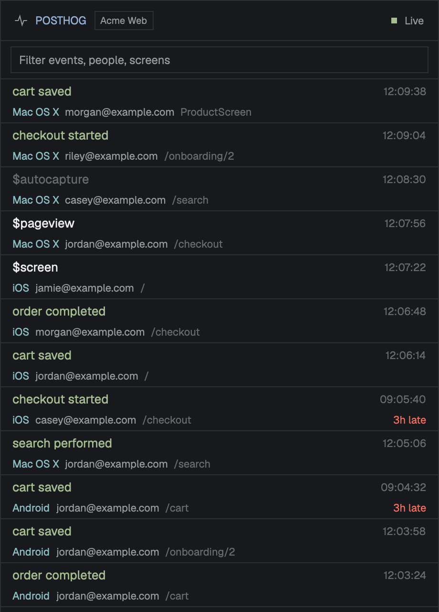

# PostHog Feed for Herdr

A [Herdr](https://herdr.dev) side panel that shows one PostHog project's events live as they arrive. The newest event is on top, with who did it, on what platform, on which screen or page, and how late it landed. Type to filter, and click an event to open it in PostHog. Add one panel per project, for example Staging and Prod.

It works in any layout: it takes the colors of your theme and the font of your layout. In the [Nightdrive](https://github.com/BenGlasser/herdr-nightdrive) layout its title takes Nightdrive's pixel face.



## Install

The simplest way is to ask the agent in your Herdr window:

> Add the Herdr mod from https://github.com/BenGlasser/herdr-posthog

Or do it by hand:

1. Copy `mods/posthog/` to `~/.config/herdr-app/mods/posthog/`.
2. Run `herdr-app check ~/.config/herdr-app/mods/posthog`.

Herdr docks it on the right of the layout you're in, the first time it sees it. Herdr's shipped layouts are read-only, so it waits for one of your own; make one with `herdr-app do layout.clone '{"name":"main","as":"my-layout"}'`.

## Setup

The first time the panel opens it asks three things:

1. **Cloud:** US or EU.
2. **Key:** a PostHog **personal API key** (`phx_…`) with the **Query: Read** and **Project: Read** scopes. It's checked with PostHog, then kept in your system keychain (the macOS Keychain, or the Secret Service on Linux; service `posthog-feed`, account = the host). Every panel on that host uses the same key.
3. **Project:** pick one from the projects the key can see, or type its id (the number after `/project/` in its URL). Click the project's name in the header to change it later.

### More than one project

Give each panel its own block in your layout, with its project in its props. Panels set this way skip the picker:

```json
{ "id": "posthog-prod", "type": "block",
  "content": { "mod": "posthog",
               "props": { "project": 12345, "label": "Prod", "prod": true, "block": "posthog-prod" } } }
```

| Prop | Meaning |
|---|---|
| `project` | The project id. Without it, the panel asks. |
| `label` | The text in the header chip. Default: the project's name. |
| `prod` | `true` makes the chip red, so production stands out. |
| `host` | Default `https://us.posthog.com`. For EU projects, use `https://eu.posthog.com`. |
| `block` | This block's `id` in the layout, so the panel can pause while it's hidden. |

## What it accesses

- **Network:** PostHog's query API (`POST <host>/api/projects/<project>/query/`), every 10 seconds while the panel is on screen. It stops while the panel is hidden and catches up when it's shown again. For the picker, once: `GET <host>/api/projects/`.
- **Programs:**
  - `security` (macOS) or `secret-tool` (Linux), to read and keep the key
  - `open` (macOS) or `xdg-open` (Linux), to open events and the key page in your browser
- **Files:** none outside its own folder.

It works on macOS and Linux.

## More

[`RECIPE.md`](RECIPE.md) is the full brief: the exact look, behavior, query, limits, and checks that prove a build works. An agent can rebuild the mod from it in an empty folder.

## License

[MIT](LICENSE).
