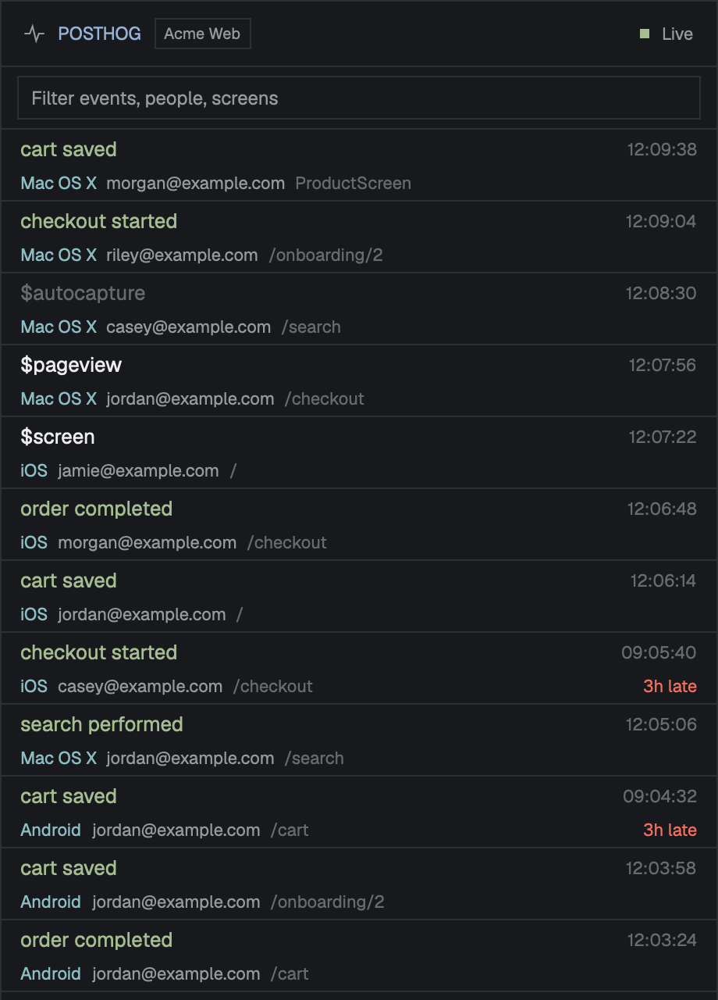

# PostHog Feed

A side panel that streams one PostHog project's events as they arrive. You get the newest first, with who did it, on what platform, on which screen or page, and how late the event landed. Type to filter, and click an event to open it in PostHog. Put one panel per project in the layout, for example Staging and Prod in the stack beside Files and Changes. All the panels share one PostHog key, kept in the macOS Keychain.



## What you see

The panel fills its block, top to bottom. Colors are theme names, so the panel follows the person's theme. The values in brackets are the [Nightdrive](https://github.com/BenGlasser/herdr-nightdrive) theme in the preview.

- **Frame:** `background` (`#05030a`) with a 1px `border` (`#2e1f55`) all round. The UI font is 13px in `foreground` (`#f3eeff`).
- **Header, 42px**, with 14px side padding, 8px gaps and a 1px `border` line under it. From left to right:
  - a 14px pulse-line icon in `muted` (`#b8a8ea`)
  - `//` in `solid` (`#ff2bd6`) and `POSTHOG` in Press Start 2P at 8px in `accent` (`#00f0ff`), 6px apart
  - the project's label (for example `Staging`) in a 1px-bordered chip: 10px text with 5px/1px padding, `border`/`muted` normally, and both `ansi1` (`#ff2a6d`) when the panel is marked `prod`
  - a spacer, then a 6px square and the status word at 11px in `muted`. The square is `ansi2` (`#05ffa1`) for **Live**, `dim` (`#8070b4`) for **Connecting**, `blocked` (`#ff2a6d`) for **No key** or **No project**, and `ansi1` for **Error**.
- **Filter bar, 40px**, with 10px side padding and a `border` line under it. It holds one 28px field with a 1px `border` and 8px padding. The input text is 12px with the placeholder "Filter events, people, screens".
- **Event list:** the rest of the height, a virtual list of 46px rows, with a vertical scrollbar laid over it. Each row has 12px side padding, a 2px gap between its lines and a `border` line under it.
  - **Line 1:** the event name, truncated, then the event time at 11px in `dim`. The time is `HH:MM:SS` for today and `MM-DD HH:MM` for older days.
  - **Line 2,** at 11px in `muted`, 6px gaps:
    - the platform (`$os`, else `$lib`) in `ansi6` (`#00f0ff`), at most 90px
    - the person (email, else name, else distinct id) at most 150px. A UUID distinct id is cut to its first 8 characters plus `…`.
    - the place (`$screen_name`, `$pathname`, `$feature_flag` or `$exception_types`) in `dim`, taking the rest
    - when the event was ingested a minute or more after it happened, a lateness tag in `blocked`: `7m late`, `3h late` or `2d late`
  - **Event name colors:**
    - `ansi1` (`#ff2a6d`): `$exception`, and any name containing "error" or "fail", ignoring case
    - `ansi5` (`#ff2bd6`): `$identify`
    - `foreground`: `$pageview` and `$screen`
    - `dim`: other `$…` events and `Application …` lifecycle events
    - `ansi2` (`#05ffa1`): every other custom event
- **Empty list:** a 12px `dim` note 10px from the top:
  - "Loading events…" before the first answer
  - "No events in the last 15 minutes yet. New ones appear here as they arrive." when there are none
  - "No events match the filter" when the filter hides everything
- **Error strip:** at the bottom while the last request failed, 11px `ansi1` text with 12px/6px padding and a `border` line above it.
- **Key form,** in place of the filter and list while there's no key. It has 14px padding, 10px gaps and 12.5px `muted` text:
  - the title "Connect PostHog" in `foreground`, semibold
  - one paragraph explaining the personal API key (Query: Read scope, kept in the macOS Keychain, shared by every PostHog panel on this host)
  - a "Create a key in PostHog ↗" link in `accent`
  - a 32px masked input (placeholder `phx_…`, 10px padding, 1px `input` border, `#7a2cff`)
  - a 32px **Save** button in `solid` with `solid_foreground` text and 14px padding
  - any problem with the key, below them in `ansi1`
- **Without a project id,** the panel shows the status **No project** and one 12.5px `muted` line under the header: "Set this block's props.project to a PostHog project id: the number after /project/ in the project's URL."

## How it behaves

- **Agent status:** the panel shows none.
- **Loading:** on start it reads the key from the Keychain and loads the last 15 minutes of events. After that it asks for new ones every 10 seconds, but only while its block is on screen. A hidden block, a hidden ancestor, or another child of its stack showing all pause it. When the block shows again, it catches up straight away from where it stopped.
- **Order:** newest ingested at the top. It fetches pages of 500 until it has caught up, then keeps the newest 500 rows, without duplicates.
- **Filter:** the list narrows as you type. The match is a case-insensitive substring of the event, person, place or platform.
- **Clicks and hovers:** a row highlights in `hover` (`#1d1038`) under the pointer. Clicking it opens that event in the default browser at `<host>/project/<id>/events/<uuid>/<event time, ISO>`. The key form's link turns `foreground` on hover and opens `<host>/project/<id>/settings/user-api-keys`.
- **Connecting:** paste a key, then click Save or press Enter.
  - A key that doesn't start with `phx_` shows "Personal API keys start with phx_."
  - Otherwise Save reads "Checking…" while the key is tried on this project with `SELECT 1`.
  - A rejected key shows "PostHog rejected that key (HTTP 403)." (or 401) and nothing is saved.
  - An accepted key is saved to the Keychain and the feed starts. Other panels on the same host pick it up on their next 10-second tick while they're shown.
- **Failures:**
  - **HTTP 401/403:** the saved key is dropped and remembered as bad. The key form returns with "PostHog refused the saved key (HTTP 403). Paste a new one with the Query: Read scope."
  - **HTTP 429:** "Rate limited by PostHog; pausing a minute." It waits 60 seconds.
  - **Anything else:** "Can't reach PostHog: …". It retries after 30 seconds.
  - In every case the rows already shown stay.
- **Motion:** none. No animation and no timers redrawing the panel.

## Built from

- **Files:** `mods/posthog/`
  - `main.js`: the whole mod, one `View`
  - `mod.json`: `{ "place": "none", "title": "PostHog" }`, so it only appears where a layout puts it
  - `activity.svg`: a 24×24 stroke icon, path `M2 12h5l3-8 4 16 3-8h5`, stroke width 1.75, square caps and miter joins, `stroke="currentColor"`, drawn with `svg()` so it takes the text color
  - `fonts/PressStart2P-Regular.ttf` and `fonts/OFL.txt`: the pixel face for the title (SIL OFL 1.1)
- **Props:**
  - `project`: required, the numeric project id
  - `label`: the chip text; default `Project <id>`
  - `prod`: `true` turns the chip red
  - `host`: default `https://us.posthog.com`; EU projects use `https://eu.posthog.com`
  - `block`: this block's id in the layout, used for the visibility check; default `posthog`
- **In a layout:** one block per project, each passing its own id as `block`. For example, as children of the stack that holds Files and Changes:

  ```json
  { "id": "posthog-staging", "type": "block",
    "content": { "mod": "posthog", "props": { "project": 12345, "label": "Staging", "block": "posthog-staging" } } },
  { "id": "posthog-prod", "type": "block",
    "content": { "mod": "posthog", "props": { "project": 67890, "label": "Prod", "prod": true, "block": "posthog-prod" } } }
  ```

  The mod has no button or key of its own. Show it the way the layout shows any stack child, with `layout.select {stack, child}` and `layout.show {id}`, from a key or a tab-bar button.
- **Herdr APIs used:**
  - `props()` (when `init` gets none)
  - `theme()`
  - `layout()`: the visibility check walks the tree. A node shows only if nothing above it is `hidden` and every stack above it has it, or its branch, `active`. A stack without `active` shows its first child.
  - `exec`, for `security` and `open`
  - `fetch`, `cx.spawn`, and `cx.timer.every(10000, …)`
  - from `gpui-base`: `InputState` (`set_masked(true)` for the key, `on("change")` for the filter, `on("submit")` for Enter), `Input`, `v_virtual_list(id, count, 46, keyOf, renderRange)` with `.on_item_click(id => …)`, and `Scrollbar.vertical(id).viewport_from_layout()`
- **Network:** `POST <host>/api/projects/<project>/query/` with `Authorization: Bearer <key>` and the body `{ query: { kind: "HogQLQuery", query }, refresh: "force_blocking", name: "herdr posthog panel" }`. The query:

  ```sql
  SELECT toString(uuid), toUnixTimestamp64Milli(timestamp), toUnixTimestamp64Milli(created_at), event,
         coalesce(person.properties.email, person.properties.name, distinct_id),
         coalesce(properties.$os, properties.$lib, ''),
         coalesce(properties.$screen_name, properties.$pathname, properties.$feature_flag, properties.$exception_types, '')
  FROM events
  WHERE timestamp >= now() - INTERVAL 2 DAY
    AND created_at >= fromUnixTimestamp64Milli(<cursor ms>)
  ORDER BY created_at ASC
  LIMIT 500
  ```

  The cursor starts 15 minutes back. After each page it moves to the largest `created_at` seen, and uuids already seen are skipped.
- **Programs:**
  - `security find-generic-password -s posthog-feed -a <host without scheme> -w` to read the key
  - `security add-generic-password -U -s posthog-feed -a <host without scheme> -w <key>` to save it
  - `open <url>` for links
- **Art:** the icon and font above. There are no images.

## Watch out

- **Row handlers:** the virtual list renders rows during layout. Registering handlers there (`.id(...).on_click`) throws, and the rows don't draw at all. Take clicks with the list's `.on_item_click`; `.hover()` styles inside rows are fine.
- **Cursor:** key it on `created_at`, not `timestamp`. Mobile SDKs batch events and send offline ones late, so a `timestamp` cursor misses them for good. The 2-day `timestamp` bound only keeps the scan small, so an event ingested more than 2 days after it happened is never shown.
- **Caching:** without `refresh: "force_blocking"` the query API answers from its cache and the feed stalls.
- **HogQL:**
  - put the cursor in as a plain integer literal; `toInt64(...)` isn't available
  - `$exception_message` isn't a property on these events, so use `$exception_types`. It arrives as JSON text, for example `["TypeError"]`.
- **Timers while hidden:** a mod's timers keep running while it's hidden, and a stack keeps every child's copy alive. So the mod must check `layout()` itself. Two blocks with this mod need different `block` props, or the check reads the wrong one. A `block` that isn't in the layout counts as always visible, so a block with a wrong id polls all the time.
- **Rate limits:** PostHog allows 2,400 query requests an hour per project. One shown panel makes about 360.
- **Inputs:** both input boxes stop the mouse-down with `cx.stop_propagation()`. Otherwise a press in them drags the panel when it's shown in a Herdr window.
- **Font:** Herdr loads a mod's `fonts/` at start and on the next look change. On a fresh install the title shows in the fallback font until a restart or theme change.
- **Platform:** macOS only, because of the Keychain and `open`. Another OS needs another secret store and URL opener.
- **Keys:** one key per host. The Keychain service is `posthog-feed` and the account is the host without its scheme (`us.posthog.com`). It must be a personal API key (`phx_…`) with Query: Read scope; project keys (`phc_…`) can't query.
- **Limits:**
  - 500 rows kept
  - the duplicate check trimmed back to the shown rows past 5,000 ids
  - a 15-minute backfill
  - a 10-second poll

## Done when

- `herdr-app check mods/posthog` passes.
- A block without `project` shows **No project** and the hint, and makes no requests.
- With no key in the Keychain:
  - the panel shows **No key** and the Connect form
  - `abc` gives "Personal API keys start with phx_."
  - a made-up `phx_` key gives "PostHog rejected that key (HTTP 403)." and nothing is saved
- With a valid key:
  - Save shows "Checking…" and then **Live**
  - `security find-generic-password -s posthog-feed -a us.posthog.com` finds the key
  - the last 15 minutes of events appear, newest first
- An event captured now shows up within about 10 seconds.
- Typing in the filter narrows the rows; clearing it brings them back.
- Clicking a row opens that event's page in PostHog in the browser.
- Showing another child of the stack for a few minutes, then this one again, brings in the events from the gap within 10 seconds.
- A second panel on the same host with `"prod": true` connects without asking for a key, and its chip is red.
- Events show in the colors listed above, and late events carry a lateness tag.
